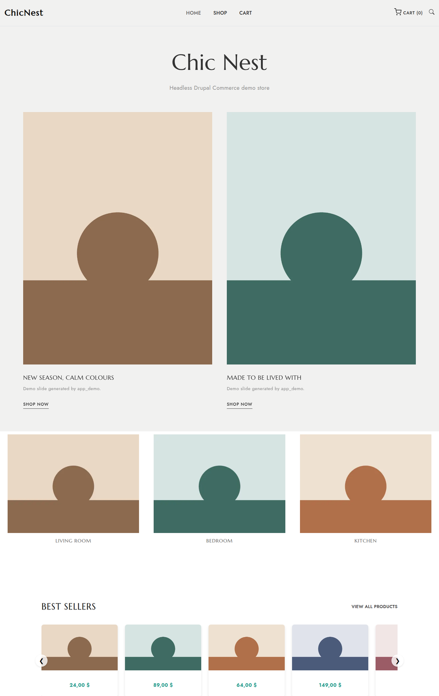
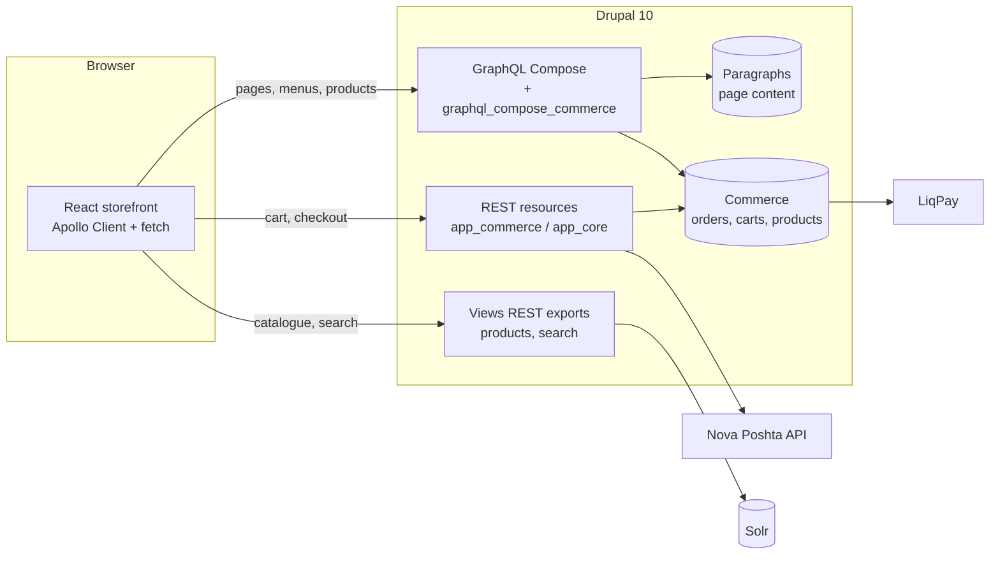
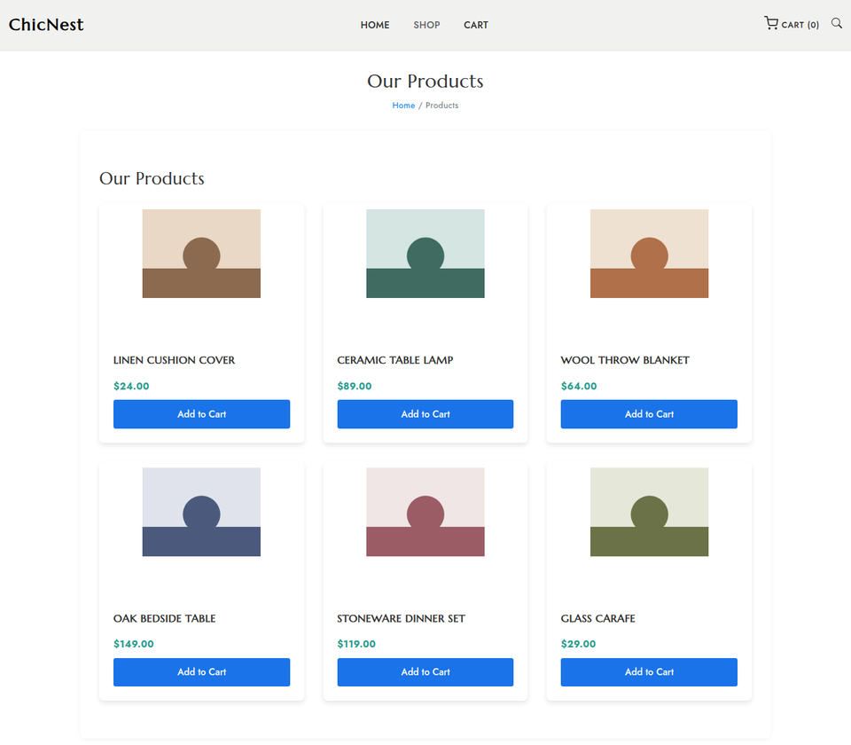
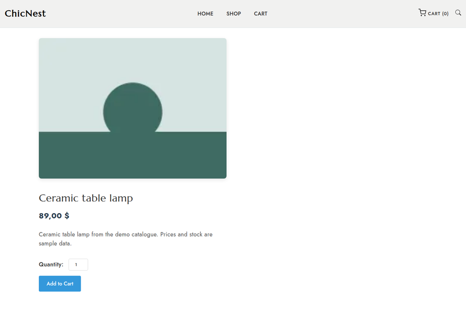

# headless-drupal-commerce-react

[](https://github.com/dimidjy/headless-drupal-commerce-react/actions/workflows/ci.yml)


[](LICENSE)

A headless online store: **Drupal 10 Commerce** as the backend and API
layer, a **React** storefront on top. Pages are built from **Paragraphs** in
the Drupal admin and rendered by React through **GraphQL**. The cart and
checkout run over a custom **REST** API with Nova Poshta shipping and LiqPay
payments. It works as a demo store and as a starting template for decoupled
Drupal Commerce projects.

<p align="center"></p>

## What's inside

- **Decoupled content.** The homepage is a Drupal node with 11 paragraph
  types: billboard slider, categories, products slider, features,
  text & image, video, testimonials, blog posts, logo bar, follow us and
  webform. React renders each one with its own GraphQL fragment
  (GraphQL Compose).
- **Commerce over REST.** The custom `app_commerce` module exposes the cart
  (add, update, remove, clear, coupons) to an anonymous storefront through a
  `Commerce-Cart-Token` header, plus checkout endpoints for shipping info and
  payment gateways.
- **Integrations.**
  - Nova Poshta: regions, cities and warehouses resolve from the Nova Poshta
    API, and the shipping step saves them on the order.
  - LiqPay: the payment gateway is wired into checkout.
  - Solr: product search through Search API.
- **GraphQL for Commerce.** `graphql_compose_commerce` adds Commerce
  products, variations, prices and orders to the GraphQL Compose schema.
- **Admin UX.** `paragraph_inline_form` adds a table-style inline widget for
  editing nested paragraphs.
- **Template-ready.** The site installs from exported config. Demo content
  is generated by a drush command, and there are no database dumps or
  secrets in the repository.

## Architecture



| Layer | Technology |
|---|---|
| Backend | Drupal 10.6, Drupal Commerce 2.41, Commerce Shipping, Paragraphs, Webform |
| APIs | GraphQL 4 + GraphQL Compose 2, core REST, Views REST export |
| Search | Search API + Search API Solr (Solr 9 via the ddev-solr add-on) |
| Integrations | `commerce_novaposhta`, `commerce_liqpay` |
| Frontend | React 18, React Router 6, Apollo Client |
| Tooling | DDEV, Composer, PHP_CodeSniffer (Drupal standard), PHPStan, GitHub Actions |

## Quick start

Requirements: [DDEV](https://ddev.com) and Node.js 20.

```bash
git clone https://github.com/dimidjy/headless-drupal-commerce-react.git
cd headless-drupal-commerce-react

ddev start
ddev setup        # composer install, install from config/sync, Solr, demo content

cd react-app
cp .env.example .env.local
npm ci
npm start         # http://localhost:3000 (the origin allowed by CORS)
```

- Drupal admin: https://hdcr.ddev.site/user/login (admin / admin)
- GraphQL explorer: https://hdcr.ddev.site/admin/config/graphql/servers/manage/default/explorer
- API check: `python3 scripts/smoke_test.py` runs the storefront's own
  GraphQL queries and REST calls against the demo site.

<p align="center">
  
  
</p>

## Project structure

```
config/sync/            exported Drupal configuration (minimal profile)
web/modules/custom/
  app_core/             page UUID mapping, path → UUID resolver for React routing
  app_commerce/         cart, checkout, shipping-info, payment-gateway and Nova Poshta REST resources
  graphql_compose_commerce/  Commerce entities and price fields for GraphQL Compose
  paragraph_inline_form/     inline table widget for nested paragraphs
  app_demo/             `drush app-demo:generate`: store, products, menus, homepage
web/themes/custom/app_theme/  minimal Drupal theme for server-rendered pages
react-app/              React storefront (pages, paragraph components, cart context)
scripts/smoke_test.py   end-to-end API checks
.ddev/                  local environment and the `ddev setup` command
```

API reference: [docs/API.md](docs/API.md).

## Configuration and secrets

`web/sites/default/settings.php` is committed and contains no credentials.
Everything sensitive comes from the environment:

| Variable | Purpose |
|---|---|
| `DRUPAL_DB_*`, `DRUPAL_HASH_SALT` | database and hash salt outside DDEV (DDEV provides its own) |
| `DRUPAL_TRUSTED_HOSTS` | comma-separated trusted host patterns |
| `LIQPAY_PUBLIC_KEY`, `LIQPAY_PRIVATE_KEY` | enables the LiqPay gateway (disabled in exported config) |
| `NOVAPOSHTA_API_KEY` | Nova Poshta API key; address lookups also work without one |
| `REACT_APP_API_BASE_URL` | Drupal base URL for the React app (`react-app/.env.local`) |

## Quality checks

GitHub Actions runs on every push:

1. **PHP:** `composer validate`, PHP_CodeSniffer (Drupal + DrupalPractice)
   on the custom code, PHPStan level 1.
2. **React:** production build with `CI=true` (lint warnings fail the build).
3. **End-to-end:** DDEV inside the runner, `ddev setup` from an empty
   database, then `scripts/smoke_test.py`. Every push proves the site
   installs from a fresh clone and that the storefront APIs answer.

## Known limitations

- The checkout **payment step is simulated in the React app**. Gateway
  selection is real (from `/commerce/payment-gateways`), but the order isn't
  placed and the LiqPay redirect isn't initiated yet.
- `webonyx/graphql-php` 14 has open denial-of-service advisories (deeply
  nested queries). The fix needs the GraphQL module's 5.x major version,
  which is a separate migration. Put a depth or complexity limit in front of
  public GraphQL endpoints until then.
- Prices use the store country's formatting (`24,00 $` for a Ukrainian
  store).
- The storefront uses Create React App. Moving to Vite is a natural next
  step.

## Credits

- The storefront design is based on the free **Kaira** template by
  [TemplatesJungle](https://templatesjungle.com/), distributed by
  [ThemeWagon](https://themewagon.com/). Its licence requires keeping the
  footer credit link.
- The demo video is **Big Buck Bunny** © Blender Foundation, CC BY 3.0.
- The demo images are generated placeholders; there are no stock photos.

## Contact

Questions, ideas or collaboration: Telegram [@dimidjy](https://t.me/dimidjy).

## License

[GPL-2.0-or-later](LICENSE), like Drupal itself.
